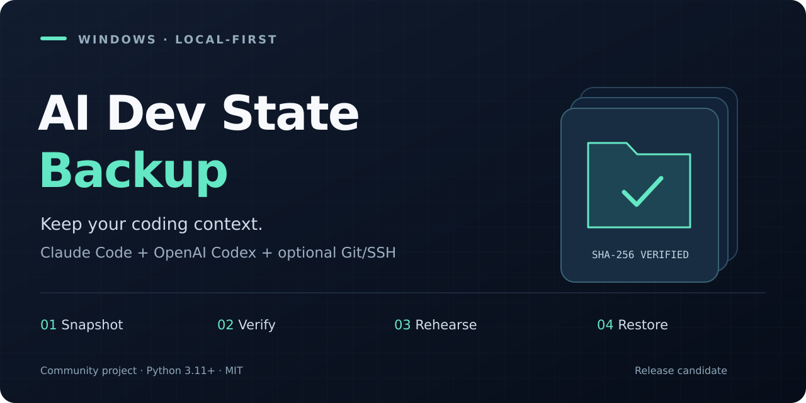

<p align="center">
  
</p>

# AI Dev State Backup

**Back up Claude Code and OpenAI Codex on Windows—before you reinstall.**

Preserve local sessions, configuration and optional Git/SSH developer state. Verify every included file with SHA-256, rehearse in a separate folder, and stage restores before changing live data.

**Windows · Python 3.11+ · No third-party runtime packages · MIT**

> **Release candidate: `2.0.0-rc.1`.** This is a safety-focused rewrite of a personal backup script, not a mature backup product. Read [validation status](docs/validation.md) and [limitations](docs/limitations.md). Keep an independent backup. The current runtime requires Python; this is not the old standalone PowerShell/BAT toolkit.

[Quick start](#quick-start) · [What it preserves](docs/scope.md) · [Restore guide](docs/restore.md) · [Troubleshooting](docs/troubleshooting.md) · [FAQ](docs/faq.md) · [Contribute](CONTRIBUTING.md)

## Keep the context that is not in Git

Reinstalling an operating system is easy to plan around your repositories. Local assistant sessions, user settings and CLI state are easier to overlook.

This tool is for developers who keep their project files separately and want to preserve the **local state around their work**. Claude Code documents local transcripts under its user configuration directory; Codex can cache credentials in local files or an OS credential store. The difference matters: preserving session files is not a guarantee that a login survives a reinstall. [Official references](docs/references.md)

## What makes it different

| Safety property | Implementation |
| --- | --- |
| No live-data restore test | Rehearsals restore into a new isolated directory, not your actual `.claude` or `.codex`. |
| No recursive-delete rollback | Existing targets are moved to private recovery holds. Failed restored copies are retained, not deleted. |
| Verify before touching live data | All selected components are staged and hash-verified before the first target is replaced. |
| Every included component is checked | SHA-256 and exact file/directory sets cover optional state as well as the main agent folders. |
| Incomplete means ineligible | A snapshot requires a valid completion marker and matching manifest checksum. |
| Explicit destinations | Restore targets come from the current account or an explicit local mapping—not old paths in backup metadata. |
| Observable, offline runtime | Hashing phases and copy/archive progress are printed. No login, package inventory or cloud API calls. |

Checksums detect accidental changes. They are **not signatures** and do not make an untrusted backup safe to restore.

## Quick start

### 1. Prepare a separate backup location

Install **Python 3.11 or newer**, then extract the complete release folder. Keep `src/`, `devstate.py` and the launchers together. Do not copy only the BATs.

Use a private **local NTFS destination** on Windows. Run as the account whose data you are backing up; administrator elevation is not normally required. Close Claude, Codex, editors and other applications that use the selected files.

```text
E:\AIBackups\toolkit\
  01_backup_dev_state.bat
  02_verify_backup.bat
  03_restore_dev_state.bat
  04_rehearse_restore.bat
  devstate.py
  src\
```

A full setup walkthrough is in [docs/usage.md](docs/usage.md). The runtime does not install Python or packages for you.

### 2. Create a backup

For the automatically detected Claude Code/Codex state:

```powershell
.\01_backup_dev_state.bat
```

To also preserve the documented SSH, Git, editor and developer-tool locations:

```powershell
.\01_backup_dev_state.bat --include-dev --output "E:\AIBackups\snapshots"
```

Review the source list and type `BACKUP`. Output is **unencrypted** and can contain tokens, private keys and private conversations. By default, snapshots go into `backups/` next to the toolkit. A ZIP and SHA-256 sidecar are also created unless `--no-archive` is specified.

### 3. Verify the copy you will keep

```powershell
.\02_verify_backup.bat --backup "E:\AIBackups\snapshots\DEV_STATE_BACKUP_<ID>"
```

To verify the ZIP itself, provide its path instead. The adjacent `.zip.sha256` file is required. To compare with current live state before reinstalling, add `--compare-live` to a directory-snapshot check.

### 4. Rehearse without touching your live profile

```powershell
.\04_rehearse_restore.bat --backup "E:\AIBackups\snapshots\DEV_STATE_BACKUP_<ID>"
```

Type `REHEARSE`. The tool exercises the real staging/restore engine against synthetic target locations in `rehearsals/`. It keeps that private test copy for inspection. **It does not rename or remove your live agent directories.** A successful rehearsal tests file restoration, not application sign-in or the ability to resume a particular conversation.

### 5. Restore after reinstalling

Install Python and the applications you use, then close those applications. First inspect a dry run:

```powershell
.\03_restore_dev_state.bat --backup "E:\AIBackups\snapshots\DEV_STATE_BACKUP_<ID>"
```

Then apply the reviewed plan:

```powershell
.\03_restore_dev_state.bat --backup "E:\AIBackups\snapshots\DEV_STATE_BACKUP_<ID>" --apply
```

Type `RESTORE`. Pre-existing targets are preserved in the journal's recovery locations. Do not delete those holds or the backup until you have personally resumed your important sessions. See [restore and recovery](docs/restore.md).

## Scope at a glance

**Default:** detected Claude Code state (`CLAUDE_CONFIG_DIR` or `.claude`), `.claude.json` files, and Codex state (`CODEX_HOME` or `.codex`). Either agent can be used alone.

**Opt-in developer state:** documented Git/SSH, GitHub CLI, shell, editor, cloud and container configuration locations. These can contain credentials.

**Opt-in desktop state:** selected desktop application/package data is archived as **manual-restore reference**. It is not a promised portable desktop-app migration.

**Not included:** arbitrary project trees, WSL distributions, OS credential vault exports, cloud-only chat history, server-side prompt caches, system images, installed application binaries, or automatic repair of old absolute paths. Agent-owned state can itself contain cached code or worktrees; “no project scan” does not mean “no code anywhere in the archive.”

See the [precise coverage table](docs/scope.md) before relying on this tool.

## Development and tests

Use a clone or the **source distribution** for these commands; the runtime ZIP omits maintainer scripts and tests. No test dependencies are needed:

```powershell
py -3 scripts/run_tests.py
py -3 scripts/check_repository.py
```

Tests create disposable synthetic data. They do not read installed Claude/Codex state or require real credentials. Windows-native ACL, file-lock, junction and BAT tests are scheduled in the configured Windows CI jobs; see [what has actually run](docs/validation.md).

Build an allowlisted, deterministic release ZIP:

```powershell
py -3 scripts/build_release.py
```

## Security and support

Never attach a real backup, session transcript, credential file or recovery journal to a public issue. `.gitignore` helps prevent accidents; it is not a security boundary. Read [SECURITY.md](SECURITY.md) and [SUPPORT.md](SUPPORT.md).

This is a community project, not an official OpenAI, Anthropic, Microsoft or GitHub utility. Trademarks belong to their owners.

## Help it improve

A reproducible bug report, a Windows compatibility result using **synthetic data**, or a safety review is especially useful. See [CONTRIBUTING.md](CONTRIBUTING.md) and the [roadmap](ROADMAP.md).

Useful for your next reinstall? A star helps you find the project again. Sharing a tested workflow or contributing a fix helps other developers more than an unverified success claim.

## License

[MIT](LICENSE).
