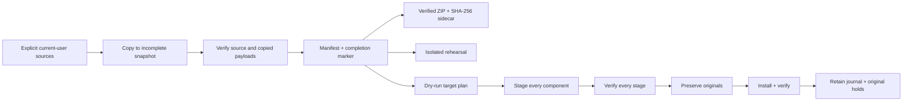

# Architecture and invariants

## Small modules, no embedded duplicate engines

`core.py` owns filesystem validation, file hashing, snapshot completion, archive verification and restore transactions. `providers.py` owns the explicit current-user location allowlist. `cli.py` owns prompts, selection, current-account mapping and the command-line contract. BATs only locate the entry point.

## Restore state machine

`preparing -> staging -> staged -> preserve-pending -> preserved -> install-pending -> installed -> complete`

The persistent journal records intent before potentially state-changing renames and records completed operations afterward. A catchable error enters reverse-order rollback. Only entries with a completed install/preservation flag are reversed. A destination is never blindly deleted. A collision during recovery leaves both copies and records `manual-recovery-required`.

A power failure is different from a caught exception: inspect the actual paths as well as the last journal. There is no claim of an atomic transaction spanning multiple volumes.

## Security boundaries

Snapshot metadata is untrusted input. Relative paths are canonicalized and reject traversal, Windows reserved/device names, alternate-stream syntax, control characters, duplicate keys, duplicate paths and case collisions. Absolute source paths are retained for reference only and never used as write destinations.

Unexpected links/reparse points are rejected before traversal. ZIP members are checked before extraction, must exactly match the manifest, and are streamed into a new destination using exclusive file creation. Archives are not extracted over live targets.

## Completion semantics

Snapshots keep only `manifest.json`, `complete.json`, and `data/`. A completion marker hashes the canonical manifest. An incomplete staging directory is never an auto-selected restore source. Once complete, the snapshot is treated as immutable. Journals, rehearsal copies and publishing artifacts live elsewhere.

## Guarantees versus evidence

These are design invariants backed by automated synthetic tests, not a guarantee against every filesystem race or future app change. See [validation.md](validation.md) and [limitations.md](limitations.md).
